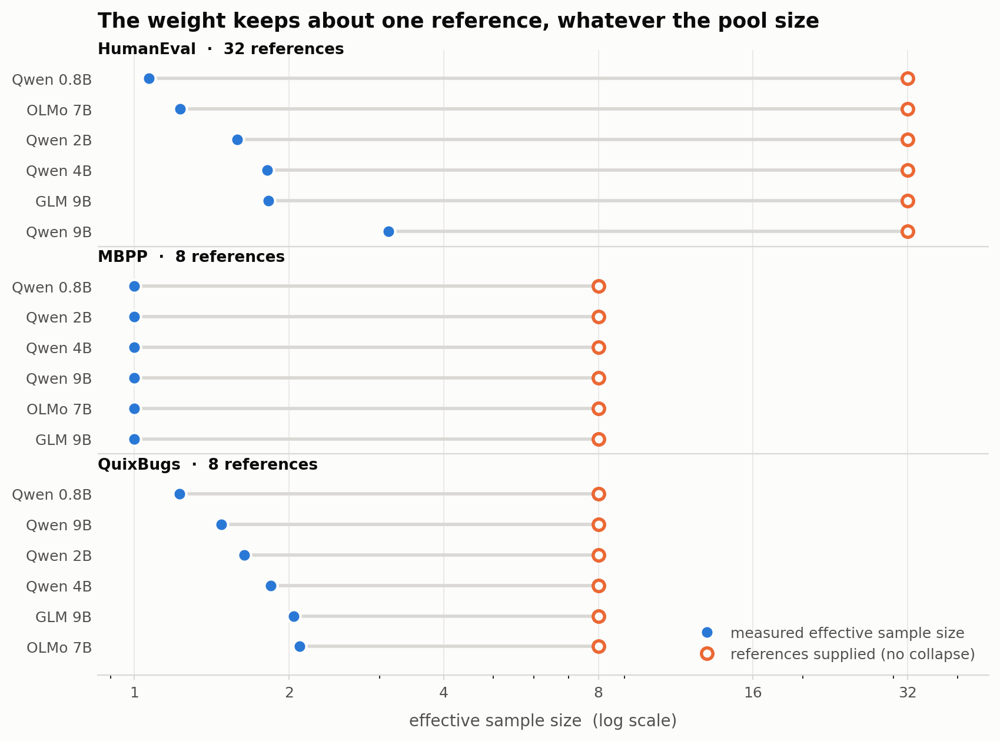
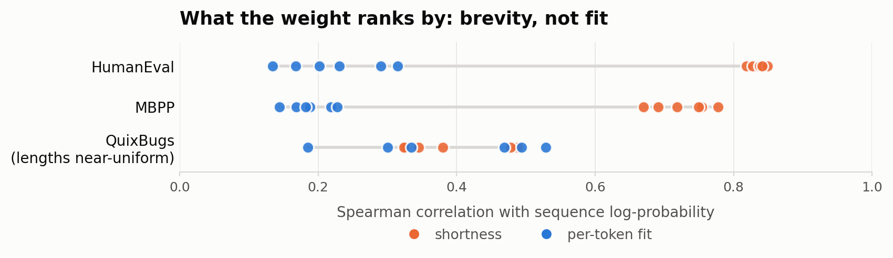

<h1 align="center">Sequence-Probability-Weighted Reference Supervision<br/>Is Dominated by One Reference</h1>

<p align="center">
  Measurement code and archived outputs for a TMLR submission.<br/>
  <sub>Anonymous supplementary material — contains no author or institution information.</sub>
</p>

---

When every sampled program in a group fails, a group-relative optimizer has nothing to learn from. The standard
fix hands the model a correct reference solution and weights it by its sequence probability. That weight is
supposed to be the density ratio between the policy and the source the reference came from — the one factor
that makes the update an estimate of the expected-reward gradient rather than of reference likelihood.

**So we counted how many references the weight actually keeps.**

<p align="center">
  
</p>

One, give or take. Eighteen model–dataset cells, six code models, three benchmarks: the effective sample size
of the weight runs **1.0 to 3.2** out of the 8 or 32 references supplied, and in all six MBPP cells it is
**1.00** — there the update is numerically a single reference's gradient.

### And it is not the reference the model has learned best

<p align="center">
  
</p>

A sequence log-probability is a sum over tokens, so short solutions start ahead. Across the full pools, sequence
log-probability ranks references by **shortness** at Spearman 0.67–0.85 but by **per-token fit** at only
0.13–0.31. QuixBugs is the control that proves it is length and not quality: its references are nearly uniform
in length, the two orderings collapse onto each other, and there the promoted reference *is* one of the
best-fitting.

Dividing by length restores coverage precisely because it removes the term doing most of the ranking — but a
geometric mean is not a density, and tempering the coefficients just returns the update to plain likelihood
fitting. **Either way the reference term is supervised learning; the weight only settles how many references
it fits.**

---

## Reproduce the headline numbers

No GPU, no model downloads, about a minute. Everything reads from `data/`.

```bash
python code/analyse/e11_promoted_reference_profile.py
```

```
reconstruction check: 18/18 cells reproduce the archived ESS
WROTE data/results/promoted_reference_profile.json
```

Run this one first. It rebuilds every diagnostic batch from the archived per-reference log-probabilities,
recomputes the coefficients, and **fails loudly if any cell disagrees with the recorded effective sample
size** — so a pass means the rest of the numbers rest on something that reconstructs. It then reports where
the promoted reference sits among its peers on fit and on length. Both figures above come straight out of it:

```bash
python code/build/make_readme_figures_ess.py
python code/build/make_readme_figures_brevity.py
python code/build/audit_paper_results.py      # re-derives data/RESULTS_AUDIT.json from the raw outputs
```

## Layout

```
code/
  measure/       produce raw measurements — loads models, needs a GPU
  analyse/       read data/ only — no GPU, no network
  build/         regenerate figures, tables, and the consolidated audit record
  checks/        sanity checks written while the experiments ran, kept for provenance
  experiments/   the measurement implementations the measure/ scripts import
data/
  RESULTS_AUDIT.json    consolidated record — all-fail counts, alignment, decay fits, training, pairing
  E7_ALL_CELLS.csv      the 54 component-level measurements behind the aggregation check
  results/              254 raw per-run outputs
assets/                 the two figures above
```

### What produced what

| Question | Script | Result |
|---|---|---|
| How often does the reward signal vanish? | `measure/e6_ess_all.py`, `analyse/pool_wilson.py` | 435 of 1,440 four-sample groups fail completely (30.2%); 4.2–64.2% per cell |
| How many references survive the weighting? | `measure/e6_ess_all.py` | effective sample size, all 18 cells |
| Which one survives, and why that one? | `analyse/e11_promoted_reference_profile.py` | fit-vs-brevity rankings and full-pool correlations |
| Does raising coverage rescue the ratio? | `measure/e6_temperature_sweep.py`, `measure/e8_length_controls.py` | tempering thresholds; per-token reweighting lifts ESS/N from 0.004–0.073 to 0.618–0.966 |
| Can a directional margin identify an objective? | `measure/e7_ksubset.py` | aggregation alone raises a component cosine 1.67–6.75×, in all 54 measurements |
| Is the direction specific to *these* references? | `measure/e6_single_cert_null.py`, the pairing control | cyclically swapping references leaves cosines of 0.075–0.584 (equal-weight) and 0.046–0.332 (weighted) |

Scripts in `measure/` load models. Point `EXPERIMENT_ROOT` at a directory holding the model and dataset caches,
and `EXPERIMENT_CODE` at `code/experiments`:

```bash
EXPERIMENT_ROOT=/path/to/cache EXPERIMENT_CODE=code/experiments \
  python code/measure/e6_ess_all.py
```

Everything in `analyse/` and `build/` resolves paths from the repository root and runs from anywhere.

## Data provenance

**One thing to know before reading anything.** `data/results/verified/` and `data/results/server2/` are two
copies of the same runs and they **disagree on MBPP by up to 6.3 nats**. `verified/` is canonical — it is the
copy that reproduces the archived effective sample sizes exactly, and the analysis scripts hard-code that
preference. `server2/` is kept only so the discrepancy stays visible rather than quietly resolved.

## Scope

These are offline gradient diagnostics: one batch per model–dataset cell, six code models, three benchmarks,
with a single-reference control and a coefficient-tempering control. The reference term is isolated from the
policy-proposal term that the unbiasedness argument also requires, so the measurements describe **that term**,
not a full training step.

No model is trained end to end and no downstream accuracy is reported. The six model columns draw on one
reference pool per benchmark and mostly promote the same reference, so the 18 cells are not 18 independent
replicates — cell counts are reported throughout rather than model-level significance.

## Citation

```bibtex
@article{anonymous2026reference,
  title   = {Sequence-Probability-Weighted Reference Supervision Is Dominated by One Reference},
  author  = {Anonymous},
  journal = {Submitted to Transactions on Machine Learning Research},
  year    = {2026},
}
```
